<link rel="stylesheet" href="style.css">

<h1>ゲームプログラマー ポートフォリオ</h1>

## 目次

- [自己紹介](#自己紹介)
- [作品概要](#作品概要)
- [ゲーム紹介](#ゲーム紹介)
- [技術的な見どころ](#技術的な見どころ)
    - [① ギミック](#ギミック)
    - [② ImGui を使ったステージエディター](#imgui-を使ったステージエディター)
    - [③ エンジンを一から作った（描画）](#エンジンを一から作った描画)
- [品質を保つための確かめ方](#品質を保つための確かめ方)
<br><br><br><br>

## 自己紹介

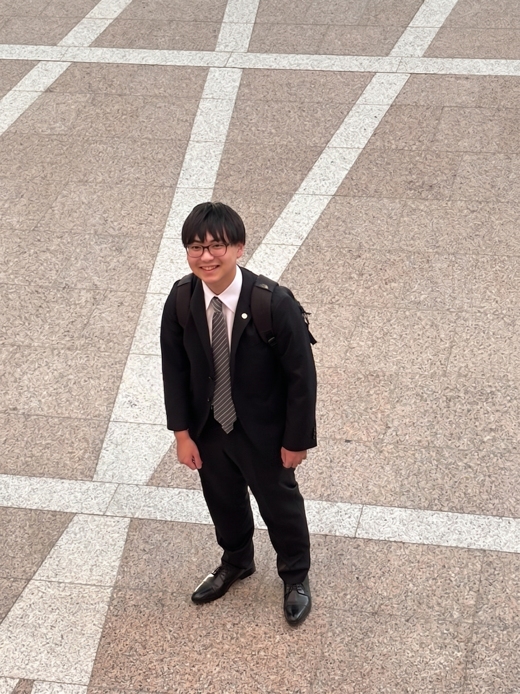

### ■ 名前
&emsp;&emsp;&emsp;**立山 虎太朗　(たちやま こたろう)**

### ■ 学校
&emsp;&emsp;&emsp;**河原電子ビジネス専門学校　ゲームクリエイター科**

### ■ メール
&emsp;&emsp;&emsp;ca01254014@st.kawahara.ac.jp

### ■ 目指している職種
&emsp;&emsp;&emsp;**ゲームプレイプログラマー**（ゲームの「遊び」の部分を作るプログラマー）

### ■ 自分の強み（長所）
的確な仕様把握に基づく、効率的なアーキテクチャの設計・実装力<br>
私は「いかに無駄なく手戻りを防ぐか」を徹底し、事前に仕様を完璧に把握した上で最適なプログラムを構築する強みを持っています。<br>
手作業の手間を排除する効率的な仕組みづくりを得意としており、本作でも、**新しいギミックを「クラス1つ＋登録1行」で足せる構造**や、**ビルドせずにステージを作り直せる ImGui のステージエディター**など、作る人が迷わず速く作業できる仕組みを自ら設計・具現化しました。

### ■ 趣味・休日の過ごし方
休日は、漫画を読んだりゲームをプレイしたりして過ごしています。<br>
最近は国内外の大自然を紹介する動画を観るのにはまっており、美しい景色や環境に触れて心をリフレッシュさせる時間が心地よい息抜きになっています。<br>
プライベートでしっかり感性を刺激し、オンとオフの切り替えを行うことが、平日の高い開発パフォーマンスや要領の良いタスク完遂へと繋がっています。

### ■ 好きなエンタメ
RPG・アクションゲーム（特に国内外のトレンドや「メトロイドヴァニア」）<br>
普段からRPGやアクションゲームを好んでプレイしており、
最近では、Nintendo Switch 2 でフルリメイクされた『ゼルダの伝説 時のオカリナ』や、『プラグマタ』、『スプラトゥーン レイダース』、『空の軌跡 the 1st』、『大悪逆令嬢 ストラテジーオブリリィ』を遊びました。<br>
中でも、特に海外のインディーシーンで熱狂的な人気を誇る「メトロイドヴァニア」というジャンルに強い関心を持っています。<br>
また、海外発の『ホロウナイト：シルクソング』をプレイし、その洗練されたレベルデザインを体感しました。<br>
世界中で愛されるこのジャンルを深く分析・研究することは、グローバルなゲーム事情やトレンドを掴むきっかけになっており、自身の開発における演出やギミックの引き出しを広げることにも繋がっています。
<br><br><br><br>

## 作品概要
| 項目 | 内容 |
| :--- | :--- |
| タイトル | Ray Seeker（レイシーカー） |
| 制作人数 | 1人 |
| 製作期間 | 2026年9月～現在 |
| ゲームジャンル | 光の謎解き × 横スクロールアクション |
| プレイ人数 | 1 |
| 対応ハード | PC (Windows 11) / Xbox コントローラー |
| 使用言語 | C++ / HLSL / Python（ツール） |
| エンジン | **OCTEngine（自作）**<br>学校配布の最小構成のフレームワーク（K2EngineLow / DirectX12）の上に、描画まわりを一から自作 |
| 使用ライブラリ | Dear ImGui / nlohmann/json / Effekseer |
| 使用ツール | Visual Studio 2026<br>Visual Studio Code<br>3ds Max 2026<br>Adobe Photoshop 2026<br>GitHub |
| GitHub URL | https://github.com/tachiyamakotaro/OCTEngine |

---


<br><br><br><br>

---

## ゲーム紹介

「その光、どこへ曲げる？」光を操って道を切り開く、横スクロールの謎解きアクション！<br>
本作は、遺跡の中を進みながら、光を反射させて仕掛けを動かし、制限時間内にゴールを目指す横スクロールアクションゲームです。<br>
【本作のウリ：小学生の理科の「光の実験」がそのままギミックに】反射鏡で光を曲げる、光で氷を溶かす、暗い所を照らす、ソーラーパネルで電気をためる、決まった色の光でセンサーを反応させる――子どもの頃に楽しかった理科の実験を思い出しながら、**現実の現象で説明できる＝初めて遊ぶ人にも伝わる** ギミックを作りました。<br>
【組み合わせで深まる謎解き】ステージ1〜3でギミックを1つずつ覚え、ステージが進むにつれて「氷＋ソーラーパネル」「暗闇＋氷」「ソーラーパネル＋色の光」のように組み合わさっていきます。最終ステージでは、それまでのギミックをすべて使った3部屋の謎に挑みます（全10ステージ）。<br>
落下でやり直すときはギミックの状態をそのまま残し、時間切れのときだけ最初からやり直す仕様にして、**「謎を解いた分は無駄にならない」** 遊び心地にしています。<br><br>
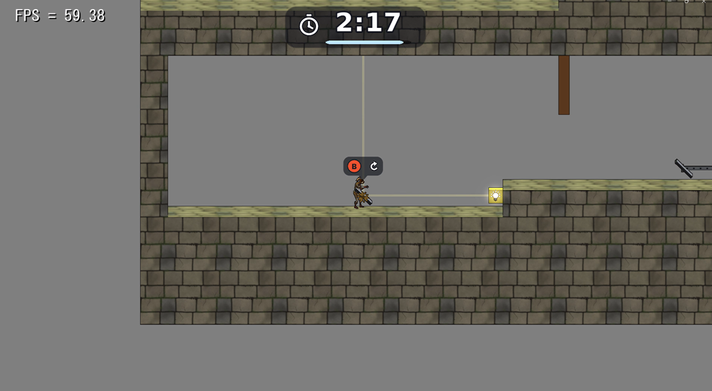<br>
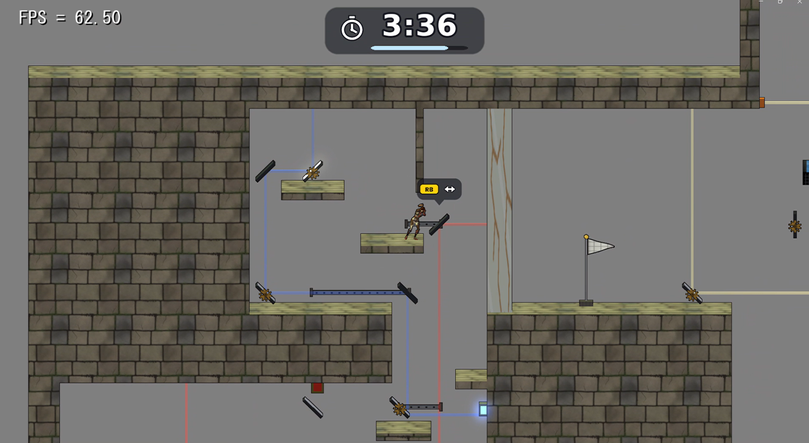


<br><br><br><br>

---

## 技術的な見どころ

本作は、**ゲームプレイ（ギミック）・ツール（ステージエディター）・エンジン（描画）** の3つを、すべて1人で作っています。

| | 見どころ | ひとことで |
| :--- | :--- | :--- |
| ① | [ギミック](#ギミック) | 反射鏡・氷・暗闇・ソーラーパネル・色の光などのギミックを、**基底クラス＋マネージャー＋登録表** で「クラス1つ＋登録1行」で足せるようにした |
| ② | [ImGui を使ったステージエディター](#imgui-を使ったステージエディター) | ステージを **JSON** で持ち、ゲームを動かしたまま配置・保存できる。**エディターはギミックの種類を知らない** |
| ③ | [エンジンを一から作った（描画）](#エンジンを一から作った描画) | 灰色の画面から、ライティング・影（VSM）・ブルーム・被写界深度・アウトラインまでを自作 |

<br><br><br><br>

## ギミック

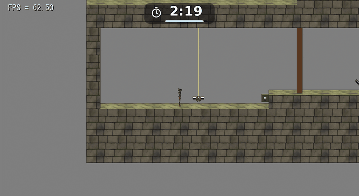

反射鏡で光を曲げ、受光器に当てて扉を開ける――本作の謎解きの中心は「光」です。<br>
光に反応するギミックを次々に足していくゲームなので、**「ギミックを足すたびに、ほかのコードを直さなくていい構造」** を最初に作り込みました。

### ギミックを「クラス1つ＋登録1行」で足せる設計

最初の作りでは、ギミックを1種類足すたびに **9ファイル・約49か所**（ステージの更新、当たり判定、光の計算、エディターの switch 文など）を直す必要がありました。<br>
ギミックが増えるほど直し忘れのバグが増えると考え、すべてのギミックが継承する基底クラス `GimmickBase` と、全ギミックを1本のリストで持つ `GimmickManager` を作り、処理を各ギミックのクラスの中に集めました。

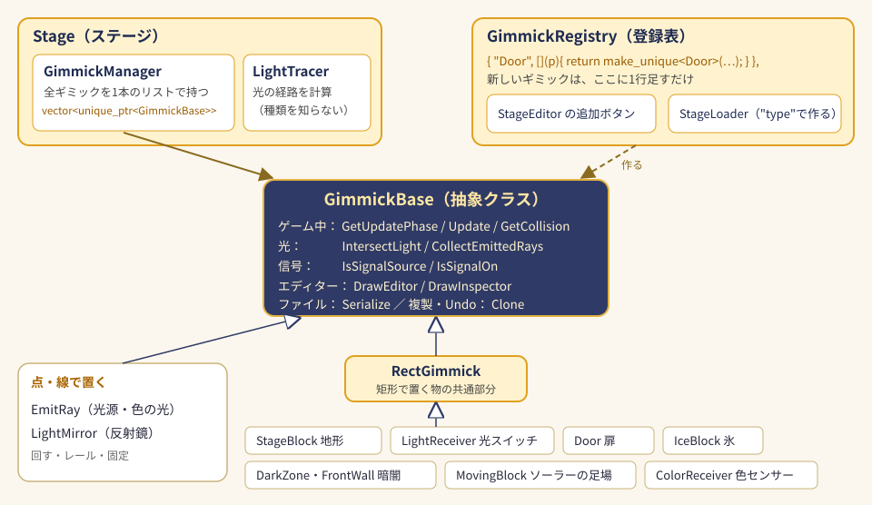

```cpp
class GimmickBase
{
public:
	// ---- ゲーム中 ----
	virtual UpdatePhase GetUpdatePhase() const { return UpdatePhase::Signal; }	// 何番目に更新するか
	virtual void Update(const GimmickUpdateContext& context) {}
	virtual CollisionKind GetCollision(math::Rect& outRect) const { return CollisionKind::None; }

	// ---- 光 ----
	virtual bool IntersectLight(const math::Vec2& origin, const math::Vec2& direction,
	                            LightHit& outHit) const { return false; }	// 光に当たったらどうなるか

	// ---- 信号（扉などのきっかけ）----
	virtual bool IsSignalSource() const { return false; }
	virtual bool IsSignalOn() const { return false; }

	// ---- エディター・ファイル ----
	virtual void DrawEditor(const EditorCanvas& canvas, bool isSelected) const = 0;
	virtual void DrawInspector(GimmickInspector& inspector) {}
	virtual void Serialize(GimmickArchive& archive) = 0;	// JSON の読み書き
	virtual std::unique_ptr<GimmickBase> Clone() const = 0;	// 複製・Undo 用
	// …
};
```

| | 作り直す前 | 作り直した後 |
| :--- | :--- | :--- |
| ギミックを1種類足すとき | 9ファイル・約49か所 | **① クラスを作る ② 登録表に1行 ③ include を1行** |
| ステージ・光の計算・エディター | 種類ごとに書き足す | **触らない**（仮想関数で決まる） |
| 既存のコード | ― | 約2,250行減（エディターは 1,855行 → 913行） |

- **必ず override するのは3つだけ**：矩形で置くギミックの共通部分 `RectGimmick` を用意し、新しいギミックは `GetTypeName` / `Clone` / `DrawEditor` だけ書けば動くようにしました。光に反応する・乗れる、などは必要な関数だけ override します。
- **ゲームのルールと見た目を分ける**：ギミックのクラスはエンジン（モデルやサウンド）に依存せず、ルールとエディター用の処理だけを持ちます。見た目は種類ごとの描画クラスが `View<Door>()` で「扉だけ」を取り出して描きます。
- **`unique_ptr` で持つ**：追加したギミックへの参照は消すまでずっと有効で、Undo は `Clone()` で中身ごとコピーします。

### 更新の順番を「ギミック自身が返す」

ギミックどうしには「スイッチを踏む → 光が届く → 受光器が光る → 扉が開く」という依存があります。<br>
マネージャーが種類を知らずに正しい順番で更新できるように、**ギミックが「自分は何番目に動くか（UpdatePhase）」を返す** 形にしました。

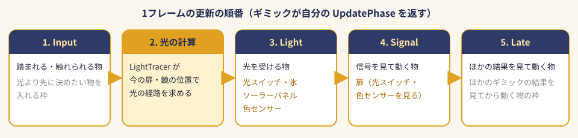

```cpp
void Stage::Update(const float deltaTime, const std::vector<math::Rect>& bodies)
{
	const GimmickUpdateContext context = { deltaTime, bodies, m_gimmicks, m_lightResult };

	m_gimmicks.Update(UpdatePhase::Input, context);	// 1. 踏まれる・触れられる物
	m_lightTracer.Trace(m_gimmicks, m_lightResult);		// 2. 光の経路を計算
	m_gimmicks.Update(UpdatePhase::Light, context);		// 3. 光を受ける物（光スイッチ・氷・ソーラーパネル・色センサー）
	m_gimmicks.Update(UpdatePhase::Signal, context);	// 4. 信号を見て動く物（扉）
	m_gimmicks.Update(UpdatePhase::Late, context);		// 5. ほかのギミックの結果を見て動く物
}
```

### 光の計算は、ギミックの種類を知らない

光の計算（`LightTracer`）は、光の線分ごとに「一番近くで当たったギミック」を探し、**そのギミックが返す反応（LightResponse）** だけを見て次を決めます。<br>
新しく光に反応するギミックを作っても、光の計算は1行も変わりません。

```cpp
switch (nearestHit.response)
{
case LightResponse::Absorb:		// 光スイッチ・氷など：光が当たったことにして止まる（光の色も記録する）
	out.AddLit(nearestGimmick, color);
	return;

case LightResponse::Reflect:	// 反射鏡：面の向きで反射して続ける
	direction = math::Normalize(math::Reflect(direction, nearestHit.normal));
	origin = hitPoint + direction * RAY_EPSILON;
	break;

case LightResponse::Stop:		// 壁など：止まる
default:
	return;
}
```

| 反応 | 使っているギミック |
| :--- | :--- |
| Stop（止まる） | 地形・閉じた扉・ソーラーパネルの付いていない面 |
| Reflect（反射する） | 反射鏡（回す・レールで動かす・固定の3種類。両面・片面も選べる） |
| Absorb（受け取って止まる） | 光スイッチ・氷・ソーラーパネル・色センサー |

### 小学生の理科から作ったギミック

「ギミックが複雑すぎて、初見の人に説明できない」という指摘を受けて、**工程が少なく、待ち時間がなく、現実の現象で説明できる** ギミックを作り直しました。<br>
すべて上の仕組みの上に作っているので、ギミックどうしを自由に組み合わせられます（色の付いた光で氷を溶かしてから色センサーに当てる、暗闇の中でソーラーパネルの足場を動かす、など）。

#### 氷（光で溶ける）
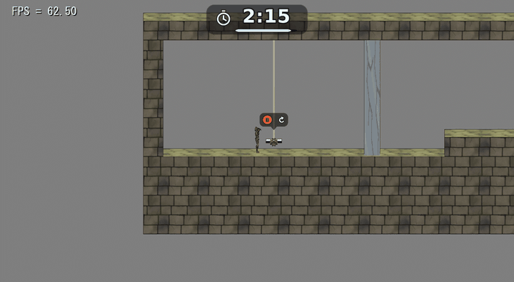

- **光が当たった「点」から穴が開く**：最初は面全体が溶ける作りでしたが、「点で当たっているのに面で溶けるのはおかしい」と指摘を受け、氷を小さなマスに分けてマスごとに熱をためる方式に作り直しました。光の通り道のまわりから掘れていき、貫通すると光が奥へ届きます。
- **通れる穴が開いたら全部溶ける**：プレイヤーの体が通り抜けられる穴があるかを、マスの上の **幅優先探索** で調べます。開いた瞬間に「穴からの距離」を測り、穴に近いマスから順に、決まった秒数で全部消えるようにしました（床でも壁でも同じ秒数）。
- **見た目は溶けるたびにメッシュを作り直す**：マスの「残り具合」から **マーチングスクエア** で穴の開いた形を作り、手前と奥の面・穴の内側の壁まで閉じた形にしています。見た目と当たり判定は同じしきい値で決めて、ずれないようにしました。
- **余熱**：光を外しても0.8秒ほど溶け続け、色もオレンジから青へだんだん戻ります。

#### 暗闇（光で照らして進む）
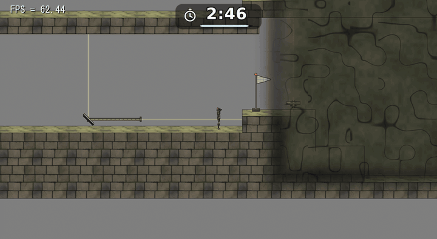

- 画面の手前に黒い半透明の板を置き、シェーダーで「光の線分のまわり」と「プレイヤーのまわり」を明るく抜いています。暗闇の中では、光の筋が穴や進む道を教えてくれます。
- いくつもの明るい所が重なる所は **1 −（1 − 明るさ）の積** で合わせ、重なりに筋が出ないようにしました。
- 板はカメラの手前にあるので、ピクセルごとに「プレイヤーがいる面のどこに重なっているか」に直してから距離を測ります。カメラが少し見下ろしていても、明るい所が光の線にぴったり重なります。
- **手前の壁**：暗い部屋の手前には岩の壁があり、プレイヤーが部屋に入った瞬間に壁がすっと透けて、中が見えるようにしました。「明るい所から暗い所へ入った」ことに説得力を持たせるための見た目で、壁が透けるまでは中の光の筋も見えません。

#### ソーラーパネル（光をためて動く床・壁）
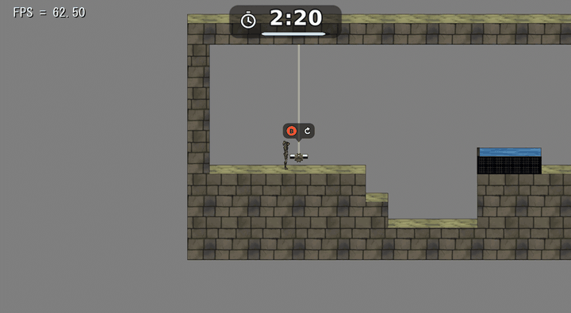

- 足場に付いたパネルに光を当てると電気がたまり、**満タンになると動き出し、ためた分だけ動く**（光から外れても動ける）。受光器（当てている間だけ動く）と役割を分けました。
- 「始点と終点の間を動く」処理を `MovePath` という部品に切り出し、継承ではなく **持たせる（has-a）** 形にしたので、ほかのギミックにも持たせれば動かせます。
- 乗っている床やつかまっている崖が動いた分だけキャラクターを運ぶ仕組み（`GetCarryDelta`）を当たり判定側に足し、**崖つかまり中・崖登り中も床と一緒に動く** ようにしました。はさまれる動きのときは床のほうを止めます。
- パネルの模様（セル・枠）はテクスチャではなくシェーダーで描き、たまった量で黒 → 灰色 → 白に光らせています。

#### 色の付いた光・色センサー
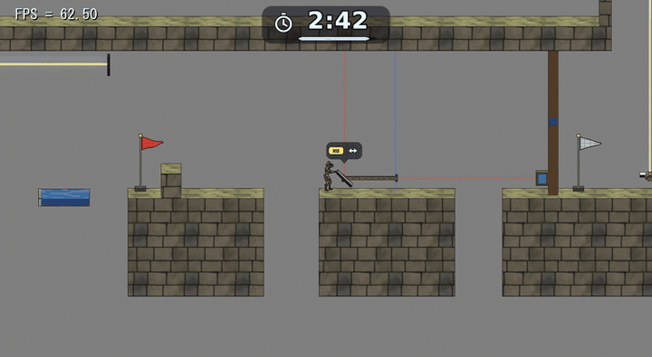

- 光源ごとに光の色（赤・緑・青の組み合わせ）を持たせ、光の線分にも色を記録して、その色で描いています。
- 色センサーは **決まった色の光のときだけ** 扉を開けます。白い光や違う色が当たっていると窓が点滅し、「光は届いているが色が違う」ことが伝わるようにしました。
- 氷・ソーラーパネル・光スイッチは何色の光でも動くので、最終ステージでは「氷は溶けたのに扉が開かない → 色が大事だ」と気づく流れにしています。
- 扉には、つながったセンサーの色の印を付けて、**扉を見ればどの色で開くか** 分かるようにしました。

### 遊んだ人の声で直したこと

先生方や友人に遊んでもらい、**「分かりにくい」と言われた所を、文字の説明ではなく見た目で伝わるように** 直しています。

| もらった声 | 直したこと |
| :--- | :--- |
| 光を当てると扉が開くのが分かりにくい | 受光器の側面に電球マークを入れ、光が当たる前から少し明るく見せる |
| 近づかないと鏡が回る・動くのか分からない | 回せる鏡には歯車、動かせる鏡には **動ける範囲と同じ長さのレール** を付ける |
| 暗闇エリアで下へ行くのが分かりにくい | 下を回らず、氷の上から右へ入る流れにステージを作り直した |

<br><br><br><br>

## ImGui を使ったステージエディター

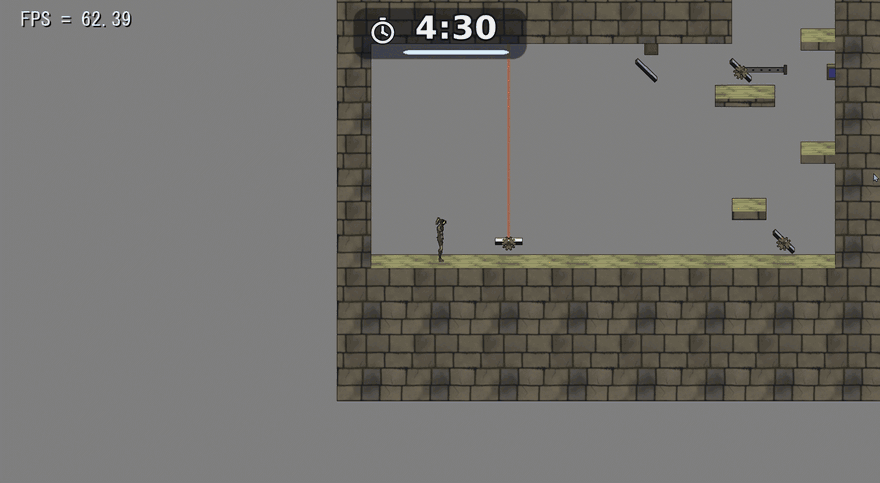

ゲームを動かしたまま、ステージの地形とギミックを配置・調整できるエディターを、ImGui で作りました。<br>
**プランナーなどほかのセクションの人でも、ビルドせずにすぐ試せる** ことを目指し、Unity のシーンビューと Inspector を参考にしています。

### できること

| 操作 | 内容 |
| :--- | :--- |
| 見取り図 | ステージを上から見た図。ホイールで拡大縮小、右/中ドラッグで移動。光の経路もそのまま表示 |
| 選択 | クリック・Ctrl+クリックで追加・何もない所をドラッグで範囲選択・Ctrl+A で全部 |
| 移動 | ドラッグ（グリッドに吸着）・矢印（X / Y の軸だけ）・選んだ物をまとめて動かす |
| 形を変える | 取っ手をドラッグして幅・高さを変える／R・Shift+R で90度回転（ソーラーパネルの面や動く向きも一緒に回る） |
| 複製・削除 | Ctrl+D / Delete |
| Undo / Redo | Ctrl+Z / Ctrl+Y（Ctrl+Shift+Z）。読み込みも Undo で戻せる |
| Inspector | 選んだ物の名前・位置・大きさ・そのギミック独自の値。扉につなぐ受光器はチェックボックスで選べる |
| 保存・読み込み | 「Save JSON」「Load JSON」。何も選んでいないときはステージの名前・プレイヤーの開始位置を変えられる |

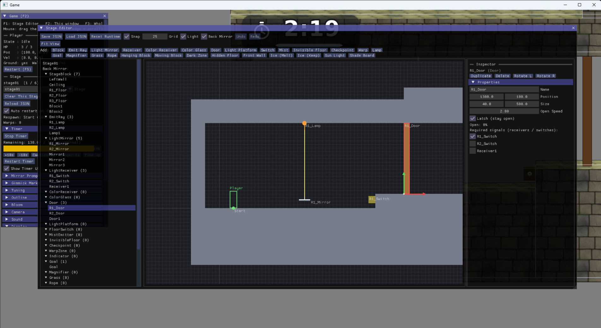

### エディターは、ギミックの種類を知らない

エディターの「追加」ボタン・一覧・見取り図・Inspector は、**登録表（GimmickRegistry）とギミックの仮想関数だけ** で作っています。<br>
作り直す前は、プロパティの表示だけで switch 文の case が15個・約220行ありましたが、今は次の数行です。新しいギミックを足しても、エディターは1行も触りません。

```cpp
case SelectionType::Gimmick:
{
	GimmickBase* gimmick = GetSelectedGimmick(stage);
	ImGui::TextDisabled("%s", gimmick->GetTypeName());

	// 名前を変えたら、扉などのつながりも新しい名前に付け替える
	const std::string oldName = gimmick->name;
	if (EditName(gimmick->name) && gimmick->IsSignalSource())
	{
		stage.GetGimmicks().RenameSignal(oldName, gimmick->name);
	}
	// そのギミック自身の欄はギミックが描く
	gimmick->DrawInspector(m_inspector);
	break;
}
```

### JSON によるデータ駆動

ステージは **「ステージの表に1行 ＋ JSON 2つ（地形・ギミック）」** で増やせます。配置の調整は JSON を直して「Reload JSON」を押すだけで、ビルドはいりません。

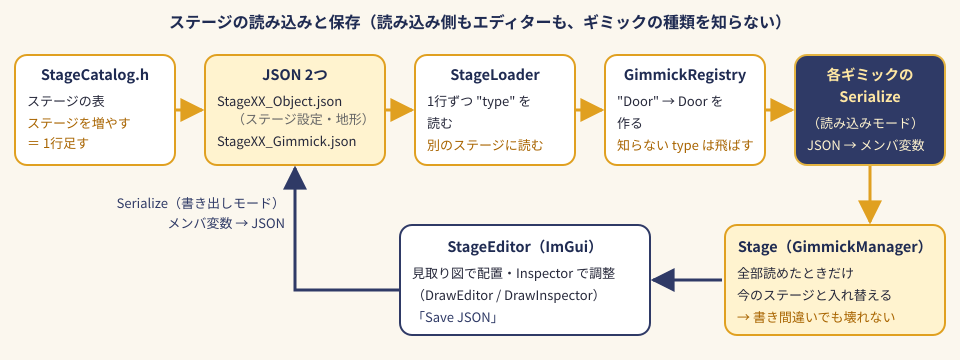

```json
{ "type": "Door", "name": "Door1", "position": [900.0, 0.0], "size": [40.0, 300.0], "requiredReceivers": ["R1"], "openSpeed": 2.0 }
```

読み込みは `"type"`（クラス名）から登録表でギミックを作り、値はそのギミックの `Serialize` に任せます。**読み込み側もギミックの種類を知らない** ので、ステージごとに登場するギミックが違っても、新しいギミックを足しても、読み込みのコードは変わりません。

### 書き出しと読み込みを1つの関数にした（Serialize）

```cpp
void Door::Serialize(GimmickArchive& archive)
{
	RectGimmick::Serialize(archive);	// "position" と "size"
	archive.Field("requiredReceivers", requiredReceivers);
	archive.Field("openSpeed", openSpeed);
	archive.Field("isLatch", isLatch);
}
```

`archive` が書き出しモードなら「メンバ変数 → JSON」、読み込みモードなら「JSON → メンバ変数」になります。**同じ関数で両方をするので、「書き出したのに読み込み忘れた」というずれが構造的に起きません。**

### 壊れにくさ

手で JSON を直すことも多いので、間違えてもゲームが止まらないようにしました。

| こういうとき | どうなるか |
| :--- | :--- |
| JSON に書いていない値 | そのクラスの初期値になる（あとから値を足しても、古い JSON はそのまま読める） |
| 知らない `"type"`・型の違う値 | その行・その値だけ飛ばして、画面にメッセージを出す |
| 文法の間違い・ファイルがない | いったん別のステージに読み、**全部読めたときだけ入れ替える**。遊んでいるステージは壊れない |

### デバッグウィンドウの整理（InGameEditor）

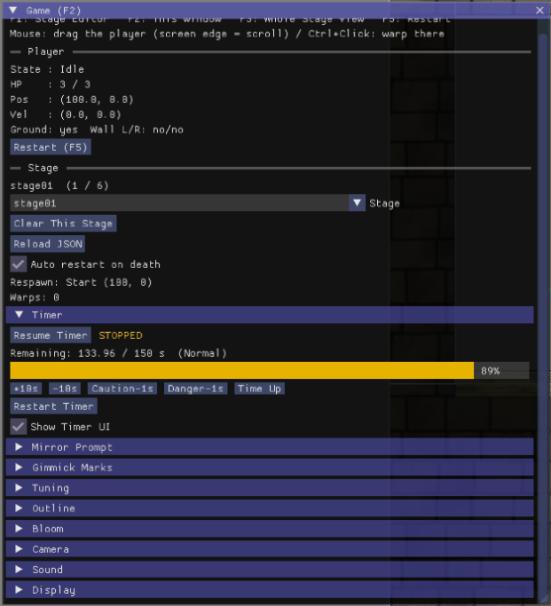

プレイヤーの調整値・カメラ・サウンド・アウトラインなどを変えるデバッグウィンドウも、1つの関数（約250行）に全部書いていたのを、**機能のフォルダごとの `○○Editor` クラス**（`PlayerEditor`・`CameraEditor` など）に分けました。

- **尋ねるな、命じろ**：ウィンドウはシーンの処理（ステージの切り替え・リスタートなど）を直接呼ばず、「押されたボタン」を戻り値で返します。シーンはウィンドウを描き終えてから、それを自分で処理します。
  ```cpp
  ApplyEditorRequest(m_inGameEditor.Draw(MakeEditorStatus()));
  ```
  これで「ボタンを押した瞬間にステージを作り直し、消えたステージを指したままウィンドウの続きを描く」という危ない順番がなくなりました。
- **デメテルの法則**：各 Editor には、その Editor が使う物だけを渡します（`PlayerEditor` にはプレイヤーの調整値だけ）。

<br><br><br><br>

## エンジンを一から作った（描画）

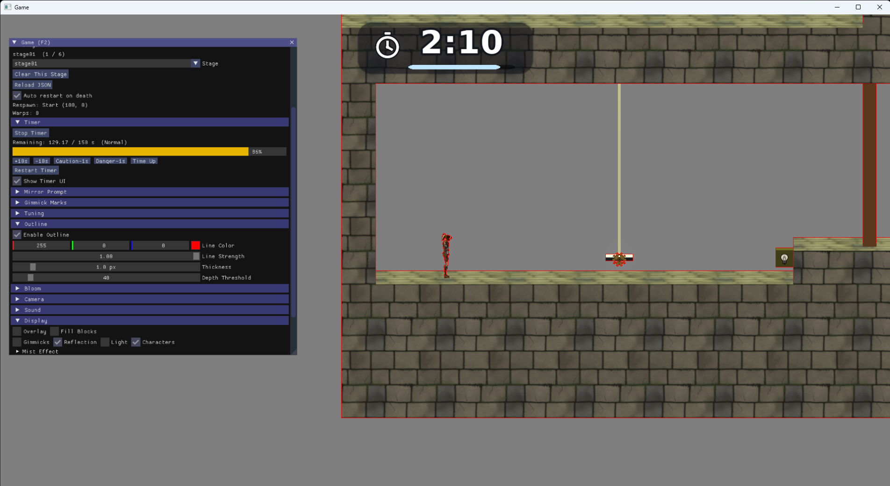

ゲームエンジンを使うのが当たり前の時代だからこそ、**描画の基礎を自分の手で理解したい** と考え、描画まわりをすべて自作しました。<br>
スタート地点は、ウィンドウと DirectX12 の初期化だけがある「灰色の画面」です。モデル描画・ライティング・影・ポストエフェクトは、すべてここから作っています。

### 自作したクラス

| クラス | 役割 |
| :--- | :--- |
| `ModelRender` / `SpriteRender` | モデル・画像を「パスを渡して、位置を決めて、描く」だけで使えるようにした部品。アニメーションの再生もここに組み込んだ |
| `SceneLight` | 平行光・環境光・ポイントライト／スポットライト（4つ）をまとめて管理し、全モデルに同じライトを渡す |
| `RenderingEngine` | `Draw` は「描きたい」を登録するだけにして、フレームの最後に **パスの順番どおりにまとめて描く** 管理人 |
| `DualBlur` | 縮小と拡大をくり返す軽いぼかし。ブルームと被写界深度で使い回す |

`ModelRender` は中に `Model` を持って仕事を任せる（**継承より委譲**）形にしています。描き方を変えるときも `ModelRender` の中だけを直せばよく、ゲーム側のコードは変わりません。

### 描画の流れ

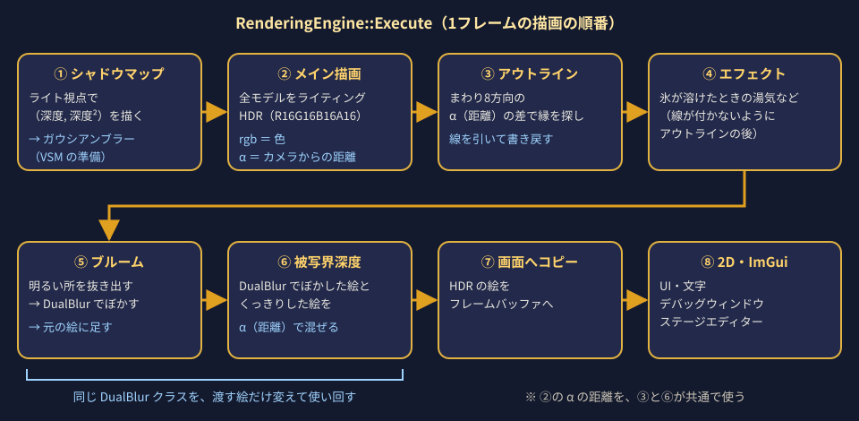

### ライティング

アンビエント（環境光）・ディフューズ（拡散反射）・スペキュラ（鏡面反射）に、スペキュラマップ・ノーマルマップ・ポイントライト・スポットライトを加えています。<br>
C++ の構造体とシェーダーの定数バッファの並び（16バイト区切り）を合わせる必要があるので、ギミック専用のシェーダーにライトの値を渡す構造体には `static_assert` を入れて、並びがずれたらビルドで気づけるようにしました。

### VSM によるソフトシャドウ

影はシャドウマップに「深度」と「深度の2乗」を描き、シャドウマップ自体をガウシアンブラーでぼかしてから、**チェビシェフの不等式** で「影である確率」を求める VSM（Variance Shadow Maps）で、縁のやわらかい影にしています。

```hlsl
float CalcShadowRateVSM(float2 shadowMapUV, float zInLVP)
{
    zInLVP -= shadowBias;
    float2 moments = g_shadowMap.Sample(Sampler, shadowMapUV).xy;	// ぼかし済みの (E[d], E[d^2])

    if (zInLVP <= moments.x) { return 0.0f; }	// 平均より手前なら光が当たっている

    float variance = moments.y - moments.x * moments.x;	// 分散 = E[d^2] - E[d]^2
    variance = max(variance, 0.00002f);
    float d = zInLVP - moments.x;
    float pMax = variance / (variance + d * d);	// 光が届く確率の上限
    return 1.0f - pMax;
}
```

### HDR と「α にカメラからの距離を書く」工夫

メインの描画先は `R16G16B16A16_FLOAT`（HDR）にして、1.0 より明るい光を持てるようにしました。<br>
さらに、**α（不透明度）には「カメラからの距離」を書いています**。不透明な物を描くときは α を使わないので、空いている場所に距離を入れておけば、後の被写界深度とアウトラインが、新しい描画先を増やさずに距離を使えます。

半透明の物（光の筋・暗闇・ガラスなど）を描くと α が上書きされて距離が壊れるので、半透明の合成では **色だけ混ぜて α は残す** ブレンドの設定にしました。

### アウトライン（深度の差で縁を見つける後処理）


アニメ調の見た目にするため、キャラクター・足場・ギミックの縁に線を引いています。<br>
モデルごとに設定がいらないように、描き終えた絵を1枚読み、**まわり8方向に自分より一定以上「奥」のピクセルがあれば、自分は手前の物の縁** として線の色にする後処理にしました。

```hlsl
float maxDiff = 0.0f;
[unroll]
for (int i = 0; i < 8; i++)
{
    float neighbor = min(sceneTexture.Sample(Sampler, In.uv + DIRECTIONS[i] * pixel).a, MAX_DISTANCE);
    maxDiff = max(maxDiff, neighbor - centerDistance);	// 隣が自分よりどれだけ奥か
}
float edge = smoothstep(depthThreshold, depthThreshold * 1.5f, maxDiff);	// しきい値付近をなめらかにしてチラつきを防ぐ
```

湯気などのパーティクルは距離を正しく書かないので、線を引いたあとに描く順番にしています。

### ギミックのための描画

エンジン側の部品を使って、ギミックの見た目もシェーダーから作っています。

| 見た目 | 作り方 |
| :--- | :--- |
| 遺跡の石積みの地形 | ワールド座標からテクスチャを貼る（足場を伸ばしても石の大きさが変わらない） |
| 溶けていく氷 | 溶けるたびに頂点・インデックスバッファを書き換える。縁ほど明るく、溶けている最中はオレンジに |
| 暗闇・手前の壁 | 光の線分（最大48本）をシェーダーに渡し、ピクセルごとに明るさを計算。手前の壁の岩の模様も、乱数を重ねてシェーダーで作る |
| ソーラーパネル | セル・線・枠の模様をパネルの角からの距離でシェーダーが描く（足場と一緒に模様も動く） |
| 電球・歯車の印 | 板1枚に、形をシェーダーで作って描く（形の外は捨てる） |

<br><br><br><br>

## 品質を保つための確かめ方

作った物が思った通りに動くか、次のように確かめてから使っています。

- **JSON を読んで保存すると、元のファイルと1文字も変わらない** こと（読み書きのずれがないこと）を確かめた
- ステージを作るときは、実際のキャラクターの動き（ジャンプ・崖つかまり・落下）で「跳び越せない」「落ちても戻れる」を確かめてから、穴の幅や高さを決めた

<br><br><br><br>

[目次に戻る](#目次)
